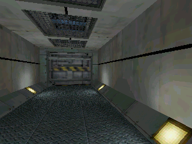

# YandexHLStation

**Half-Life 1 на Яндекс Станции Лайт первого поколения.**
Игра, физика, одиночная кампания и программная отрисовка выполняются на ARM-процессоре колонки. Браузер получает PNG 320×240 и отправляет ввод. Внешнего игрового сервера нет; данные кампании находятся во внутренней флеш-памяти.



Проверено на YNDX-00025: 4 × Cortex-A53 1,2 ГГц, около 238 МиБ RAM, Linux 4.9.68, ARMhf/glibc 2.30. Первая карта, поездка на трамвае, переходы между картами, управление из браузера и звуковой поток работают. Полное прохождение кампании и установка на второй чистой колонке не проверялись. Частота передачи PNG в интерфейсе — не FPS движка.

## Что опубликовано

Скрипты запуска и упаковки, браузерная панель, ARM HTTP/XTest/ALSA-мост, патч Xash3D, параметры сборки и результаты проверок. Игровые файлы Valve, сохранения, прошивка, BusyBox/библиотеки с устройства и чужие учётные данные не включены. Потребуется собственная установленная копия Half-Life и уже полученный root по ADB.

Это зафиксированная рабочая конфигурация эксперимента. Пока используется базовый ARMhf chroot от [YandexMCStation](https://github.com/F1xTrack/YandexMCStation): нужны только BusyBox, glibc, Xvfb, X11/XTest, ALSA и шрифты. Java, Minecraft и LWJGL для Half-Life не нужны и на колонку не устанавливаются. Здесь нет универсального установщика прошивки.

## Подготовка базового окружения

На Linux x86-64 подготовьте зависимости проекта YandexMCStation по его инструкции `pull-base`/`build`, **не устанавливая Minecraft на колонку**. Из его `build/runtime` используются только базовые библиотеки/инструменты. На рабочей Станции этот chroot уже был в `/data/minecraft`; имя каталога историческое.

В этом репозитории создайте ссылки на подготовленные библиотеки и заголовки:

```sh
mkdir -p build
ln -s /path/to/YandexMCStation/build/runtime build/shared-runtime
ln -s /path/to/YandexMCStation/build/include build/include
```

Для Xash3D/SDL2 нужен GCC ARM 9.2-2019.12 `arm-none-linux-gnueabihf` с glibc 2.30. Распакуйте его в `toolchains/gcc-arm-9.2-2019.12-x86_64-arm-none-linux-gnueabihf`.
Установите на хосте `git`, `make`, `cmake`, `python3`, `python3-pil`, `squashfs-tools`, `pkg-config`, заголовки X11/ALSA/zlib. ARM-заголовки ALSA и ссылки на ARM-библиотеки размещаются в `deps-armhf/include` и `deps-armhf/lib`.

## Движок

Версии исходников записаны в `sources.lock.json`:

```sh
git clone --recursive https://github.com/FWGS/xash3d-fwgs.git
git -C xash3d-fwgs checkout d6b54aaf6c1d8518e08404a842f3f6ee02cef3cc
git -C xash3d-fwgs submodule update --init --recursive
git -C xash3d-fwgs apply ../patches/xash3d-station.patch
git clone https://github.com/FWGS/hlsdk-portable.git
git -C hlsdk-portable checkout 8a09758d2912d278423870391f6c25995de0000b
```

Распакуйте SDL2 2.32.10 как `SDL2-2.32.10/`, затем:

```sh
sh build_engine.sh
cmake -S hlsdk-portable -B build/sdk \
  -DCMAKE_TOOLCHAIN_FILE="$PWD/station-toolchain.cmake" \
  -DCMAKE_BUILD_TYPE=MinSizeRel -DLTO=ON
cmake --build build/sdk -j4
sh build_web.sh
```

Критично: на ARMhf модули называются `valve/cl_dlls/client_armv7hf.so` и `valve/dlls/hl_armv7hf.so`. Даже если CMake выбрал другой суффикс выходного файла, установите эти имена. `client.so`/`hl.so` движок распознаёт как другую ABI. Официальный готовый современный Xash3D требует более новой glibc; эта сборка использует системную 2.30. `-h` в Xash означает справку: размер задаётся `-width 320 -height 240`.

Патч сохраняет длительность MP3-in-WAV, принимает короткие MP3, разворачивает компактные текстуры до логического размера BSP в RAM, исправляет RGB565 → RGB888 и увеличивает звуковой буфер до 2048 кадров на Станции.

## Данные игры во флеш-памяти

```sh
python3 compact_assets.py --source /path/to/Half-Life/valve --output private/valve \
  --texture-size 64 --texture-colors 256 --texture-filter box \
  --light-bits 5 --model-colors 128
python3 verify_compact_assets.py /path/to/Half-Life/valve private/valve
mksquashfs private/valve private/hl-assets.sqfs -comp xz -b 262144 \
  -noappend -processors 4 -all-root -no-xattrs -no-progress
```

На проверенной сборке образ занимал 60 817 408 байт, около 58 МиБ. Размер повторной упаковки может отличаться. Сохранены все 103 карты кампании/обучения, 89 AI-графов, геометрия, коллизии, переходы, речь, анимации и 27 музыкальных треков. Текстуры уменьшены, освещение квантовано, модельные палитры сокращены. Сетевая игра, лишние пользовательские модели и стартовые видео убраны.

В ядре Станции нет SquashFS, поэтому образ читает `squashfuse_ll`. Для сборки распакуйте FUSE 2.9.9, XZ 5.2.5 и squashfuse 0.6.5 в соответствующие каталоги, затем `sh build_compact_fs.sh`. `mount-assets.sh` монтирует образ read-only; для игры NFS не требуется.

## Размещение на устройстве

В базовом chroot `/data/minecraft`:

- `halflife/`: stripped Xash3D, `libxash.so`, `filesystem_stdio.so`, `libref_soft.so`, `libmenu.so`, SDL2, `libstdc++`, `libgcc_s`, ARM-модули HLSDK в `valve/`, `extras.pk3` из mainui, `autoexec.cfg`, `asound.conf` и `game-launch.sh` как `launch.sh`.
- `bin/station-web`: результат `build_web.sh`.
- `bin/squashfuse_ll`: результат `build_compact_fs.sh`.
- `hl-assets.sqfs`: собственный упакованный образ игры.
- `hl-mount-assets.sh`: `mount-assets.sh` из репозитория.
- `hl-launch.sh`: `station-launch.sh` из репозитория.

Скрипты должны иметь право выполнения. Перед копированием бинарников остановите старый процесс: нельзя перезаписывать загруженную `.so`. Сохранения лежат отдельно в `halflife/valve/save/`.

```sh
adb connect 192.168.1.100:5555
adb -s 192.168.1.100:5555 shell 'sh /data/minecraft/hl-launch.sh'
```

Лаунчер останавливает штатный Quasar, монтирует proc/dev/tmp, создаёт zram, запускает Xvfb, мост и игру. Отдельно работающий альтернативный ассистент также должен быть остановлен. Root-раздел и Wi-Fi не изменяются. Автоматический старт после включения питания здесь не настроен.

## Браузер и звук

На хосте:

```sh
HALFLIFE_STATION_VIEWER=http://192.168.1.100:12080 \
HALFLIFE_WEB_BIND=0.0.0.0 HALFLIFE_WEB_PORT=12081 python3 web.py
```

Откройте `http://IP_ХОСТА:12081`. Это только прокси изображения/ввода, вычисление кадров остаётся на Станции. Страница рассчитана на домашнюю сеть и не содержит авторизации.

WASD, мышь, Space — прыжок, Ctrl — присесть, E — использовать, R — перезарядка, F5/F9 — быстрое сохранение/загрузка. На колонке: пауза — прыжок, микрофон при удержании — вперёд, `+`/`−` — обзор; их сочетания соответствуют действиям мыши.

Ползунок 0–100% управляет **TAS5805M Digital Playback Volume**: 1% = −60 дБ, 100% = 0 дБ, 0% — цифровая громкость 0 и выключенный выход. При каждом запуске игры/моста устанавливается 0%. Старый виртуальный `Master` прямой PCM-поток обходил, поэтому его больше не используем. Звук идёт из колонки, в браузер аудио не передаётся.

## Проверки и ограничения

`validation/` содержит результаты проверки ресурсов и исправления громкости; это снимки эксперимента. Все файлы финального SquashFS извлечены и сравнены со сборкой, SHA-256 проверен на устройстве. Настоящий игровой кадр показан выше. Внутренний цвет программного рендера — 16 бит; мировые lightmap в этом рендере монохромные. Разгон и изменение напряжений не применялись.

Браузерные smoke-проверки используют `puppeteer-core` и Chrome. Аудиопроверка кратко меняет громкость: запускайте её, когда колонкой никто другой не управляет. Полное прохождение не проверено.
